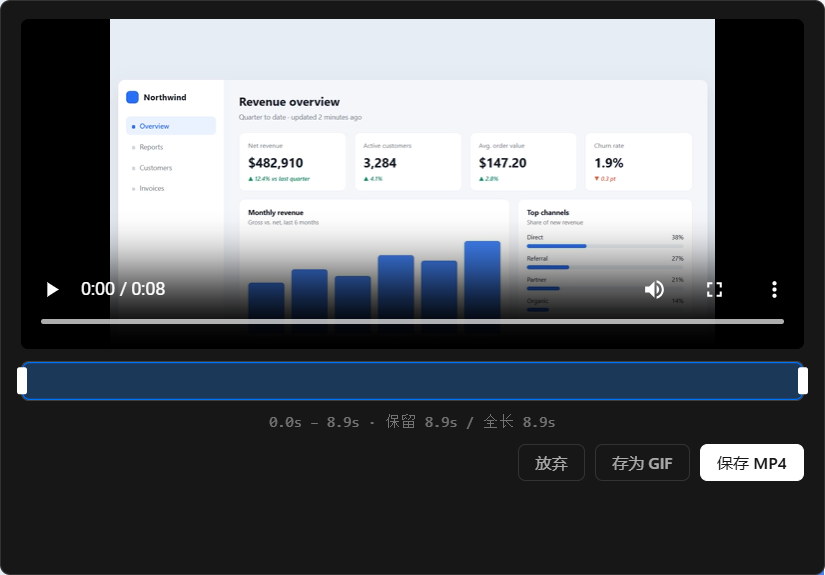
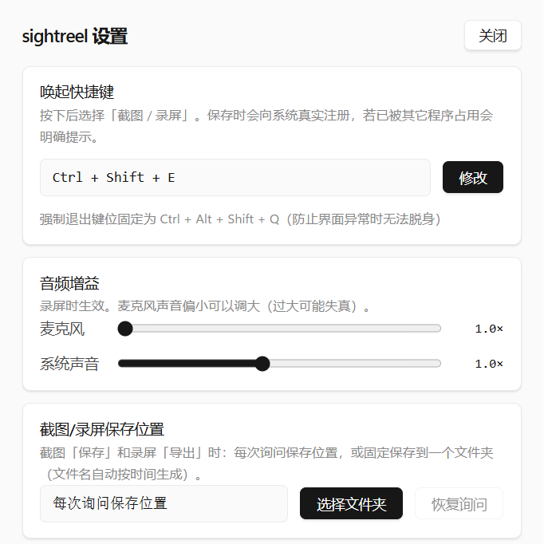

<div align="center">

# Sightreel

**让 AI 看得见自己做过的事 · 轻量截图 / 录屏应用**

[](LICENSE)


简体中文 | [English](README_EN.md)

</div>

---

## 为什么做 Sightreel

Agent 已经能替我们点按钮、跑流程、剪视频，但它看不见自己做完之后屏幕变成了什么样。截图只留下一个瞬间，文字日志没有画面；真正接近"亲眼看了一遍"的记录方式是视频——画面、时序、节奏都在里面。

Sightreel 把截图与录屏做成 Agent 可以直接调用的命令，同时给人一套称手的图形界面。名字取自 sight + reel：给机器一双眼睛，也给操作留一卷底片。

## 两种用法

### 给 Agent：一条命令

```bash
# 开始录制，不预设时长；Agent 认为够了就创建 stop.flag
sightreel record --stop-file D:/rec/stop.flag --out D:/rec/demo.mp4

# 进程退出时 stdout 恰好一行 JSON
{"ok":true,"path":"D:/rec/demo.mp4","seconds":38.2,"stopped_by":"stop_file",...}
```

录制结束后，可以让工具直接给出"导演视角"的信息，也可以把视频原样交给多模态模型：

```bash
sightreel analyze --in demo.mp4 --frames 6 --sheet sheet.jpg
# 时长、分辨率、帧率、场景切换点、分段与关键帧路径，一次返回
```

### 给人：托盘 + 快捷键

托盘常驻，快捷键唤起后选择「截图 / 录屏 / 摄像头」：框选截图、标注后复制或保存；区域录屏、在时间轴上选段、导出 MP4 或 GIF。默认不打扰——没有账号、没有弹窗、没有常驻进程（图形界面本身除外）。

## 核心特性

- **极致轻量** —— CLI 模式不建窗口、不注册热键，进程退出即释放全部资源；GUI 才常驻托盘以承接全局快捷键
- **指针可视化** —— 屏幕采集本身不含鼠标；工具把系统真实指针图标原样合成进画面，并沿图标轮廓发散一层蓝色微光，让 AI 看清点击与拖拽落在哪里（可用 `--no-cursor` / `--no-glow` 关闭）
- **截图与标注** —— 智能窗口识别与区域框选，内置矩形、箭头、画笔、文字、马赛克，一键复制或保存
- **录屏与选段** —— 区域或整屏录制，导出 MP4 / GIF；录制完成可在时间轴上只保留需要的片段
- **声音** —— 麦克风与系统声音可分别开启、分别调节增益，输出混流为一条音轨
- **时间轴与关键帧** —— `analyze` 给出场景切换点与分段，`--frames` / `--sheet` 顺带抽取关键帧或拼图；看流程用视频，看 UI 细节用关键帧，更省 token
- **面向自动化的接口** —— 无头 CLI、stdout 单行 JSON、`--stop-file` 随时中止、`--window` 按窗口标题录制、`--fps` / `--scale` / `--crf` 控制体积，`help --json` 输出机器可读能力声明（见 [SKILL.md](SKILL.md)）
- **本地优先** —— 无账号、无遥测，默认零网络请求

## 界面

<p align="center">
  <b>智能框选：拖拽选区、单击选窗口</b><br/>
  
</p>

<p align="center">
  <b>截图标注：矩形、箭头、画笔、文字、马赛克</b><br/>
  
</p>

<p align="center">
  <b>录后选段：时间轴上只保留需要的片段</b><br/>
  
</p>

<p align="center">
  <b>设置：快捷键、音频增益、保存位置</b><br/>
  
</p>

## 安装与构建

- **安装包**：Windows 10 及以上，从 Releases 下载 `sightreel_<版本>_x64-setup.exe` 安装即可，无需另装 FFmpeg
- **从源码**：需要 [Node.js](https://nodejs.org/) + [pnpm](https://pnpm.io/) + [Rust](https://rustup.rs/)

```bash
pnpm install
pnpm tauri dev        # 开发调试
pnpm tauri build      # 打包（需先准备 vendor/ffmpeg.exe）
cd src-tauri && cargo test   # 102 个单元测试
```

打包会把 FFmpeg 一并写入安装包；仓库不内置该二进制，从源码打包前请把 `ffmpeg.exe` 放到 `vendor/`。运行时也可用环境变量 `SIGHTREEL_FFMPEG` 指定自定义路径，装好后跑 `sightreel doctor` 复核。日志目录可用 `SIGHTREEL_LOG_DIR` 指到其它磁盘。

开发细节、架构约束与待办见 [docs/DEVELOPMENT.md](docs/DEVELOPMENT.md)。

## 许可证与第三方

本项目以 [MIT](LICENSE) 发布。

安装包内置的 FFmpeg 来自 [gyan.dev 的 essentials build](https://www.gyan.dev/ffmpeg/builds/)（8.1.1，`--enable-gpl`），以 GPLv3 分发。它作为独立可执行文件随安装包提供，源代码见 [ffmpeg.org](https://ffmpeg.org/download.html)。如需完全宽松许可的分发方式，可不使用内置版本，改用 `SIGHTREEL_FFMPEG` 指向自备的 FFmpeg。
