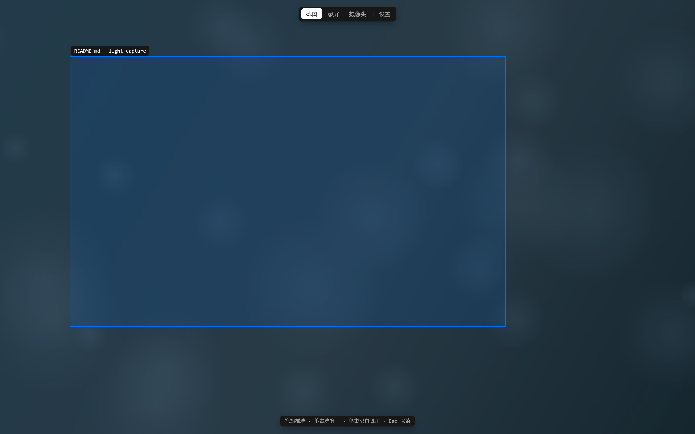
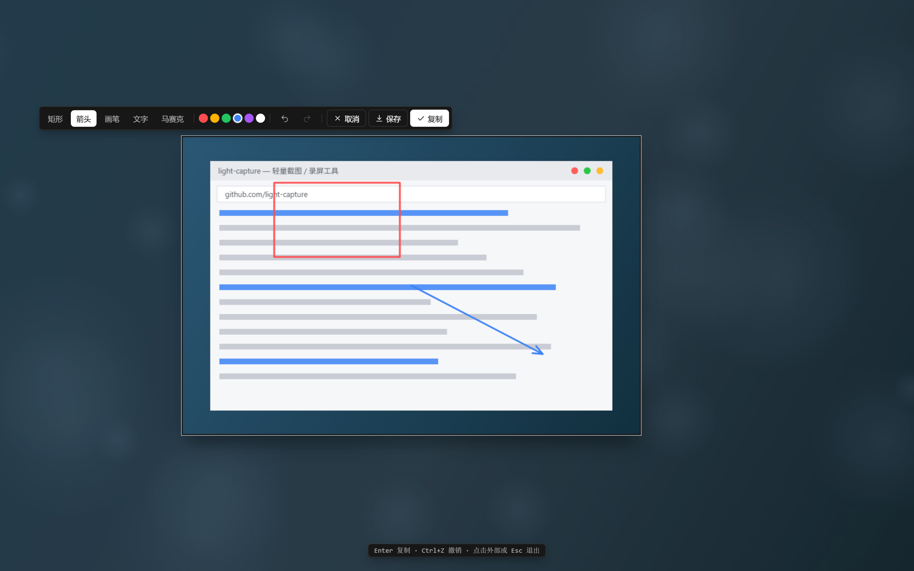
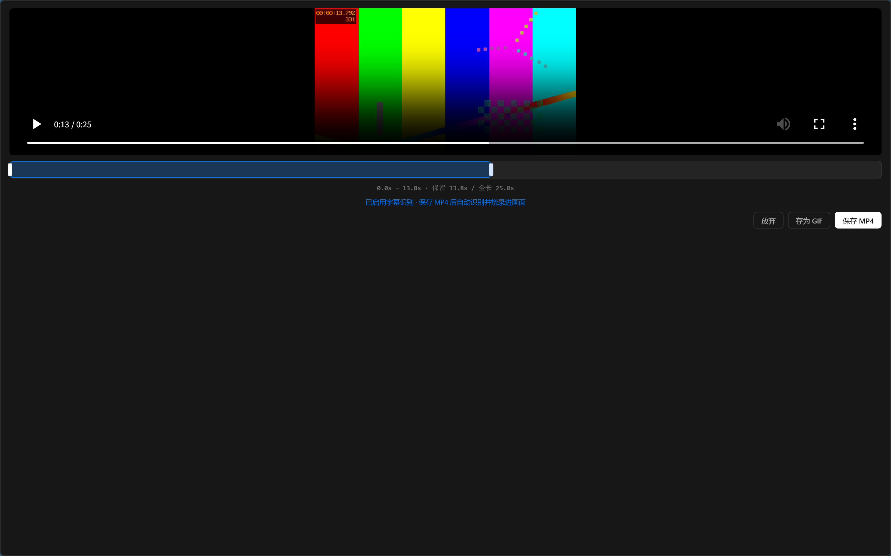

<div align="center">

# light-capture

**轻量级 Windows 录屏 / 截图工具 —— 让 AI Agent 能够回看自己的执行过程**

[](LICENSE)


简体中文 | [English](README_EN.md)

</div>

---

## 解决什么问题

AI Agent 正在承担越来越多的自动化工作：软件测试、RPA 流程、视频素材处理等。这类任务有一个共同的缺口——Agent 完成操作后，缺少确认实际执行效果的手段：截图只能反映某一瞬间，文字日志缺少画面信息。

视频同时包含画面、时间与节奏，是目前信息密度最高的记录方式。light-capture 将录屏能力以一条命令的形式提供给 AI：Agent 自主录制屏幕、取回视频文件，再交给多模态模型回看分析，构成完整的「执行 → 录制 → 回看 → 校正」闭环。

## 工作方式

```text
① 录    Agent 执行一条命令开始录屏，期间可随时中止
② 收    录制结束，stdout 返回一行 JSON，包含视频文件路径
③ 看    Agent 将视频交给多模态模型回看，据此决定下一步
```

```bash
# 发起录制：不设固定时长，用"停止文件"随时中止
light-capture record --stop-file D:/rec/stop.flag --out D:/rec/demo.mp4

# （Agent 认为录制足够时，创建 stop.flag 文件，录制立即结束）

# 进程退出，stdout 恰好一行 JSON：
{"ok":true,"path":"D:/rec/demo.mp4","seconds":38.2,"stopped_by":"stop_file",...}
```

视频就是普通的本地文件：无平台绑定、无账号、无上传，Agent 可以将其交给任意支持视频输入的多模态模型。

## 核心特性

- **极致轻量** —— AI Agent 普遍消耗大量硬件资源，本工具刻意做减法：无常驻进程、空闲时零消耗，仅在录制时占用必要的编码资源；托盘 + 全局快捷键，一键唤醒即用
- **录屏与视频选段** —— 支持区域录屏，导出 MP4 / GIF；录制完成后可在时间轴上选取片段，只保留需要的部分
- **截图与标注** —— 智能窗口识别与区域框选，内置标注工具，支持复制与保存
- **面向自动化的接口** —— 无头 CLI 模式，stdout 单行 JSON 契约，`--stop-file` 随时中止，`help --json` 输出机器可读能力声明（见 [SKILL.md](SKILL.md)）
- **本地优先** —— 无账号、无云上传、无遥测；不录屏时零网络请求，数据全部留在本机

## 典型场景

| 场景 | light-capture 的作用 |
| --- | --- |
| 软件测试 | Agent 操作界面后回看录像，逐步核对点击、跳转与显示是否符合预期 |
| 自动剪辑 | Agent 先回看素材，理解节奏与内容后再进行剪辑 |
| 流程复盘 | 自动化流程执行完毕，以视频为依据审查效果、定位问题 |
| 演示制作 | Agent 录制操作过程，直接产出可交付的演示视频 |

## 接入说明

- **无头 CLI**：不创建窗口、不注册全局热键、零常驻，进程退出即释放全部资源，可与图形界面并存
- **stdout 契约**：成功 `{"ok":true,...}`，失败 `{"ok":false,"error":...}`，退出码 0/1，过程日志只写入本地文件
- **随时中止**：`--stop-file` 指定的文件一出现录制立即结束（百毫秒级响应），停止后自动清理
- **能力发现**：`light-capture help --json` 输出机器可读的能力声明；完整的触发与调用指引见 [SKILL.md](SKILL.md)
- 截图同样可用：`light-capture screenshot --out shot.png [--region x,y,w,h]`

## 人也能用

同一应用附带图形界面：托盘常驻 + 快捷键一键唤醒，智能框选截图、区域录屏、时间轴选段与标注导出。

| 智能框选 | 截图标注 | 录后选段 |
| --- | --- | --- |
|  |  |  |

## 隐私

数据全部留在本机：无账号、无云上传、无遥测；不录屏时零网络请求，日志仅写入本地文件。

## 从源码构建

<details>
<summary>构建步骤</summary>

- Windows 10 及以上，安装 [pnpm](https://pnpm.io/)、[Rust](https://rustup.rs/)、[FFmpeg](https://ffmpeg.org/)（加入 PATH）

```bash
pnpm install
pnpm tauri dev        # 开发调试
pnpm tauri build      # 打包
cd src-tauri && cargo test   # 62 个单元测试
```

</details>

## 许可证

[MIT](LICENSE)
